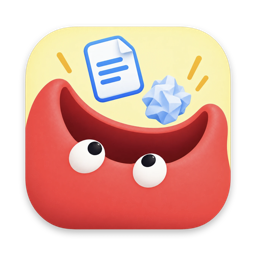

<p align="center">
  
</p>

<h1 align="center">Junky</h1>

<p align="center">
  A friendly Mac cleaner. Clear out junk, find big forgotten files and duplicates,<br>
  uninstall apps completely, and keep an eye on your Mac from the menu bar.
</p>

<p align="center">
  <a href="https://github.com/LFECode/Junky-releases/releases/latest/download/Junky-1.0.1.dmg"><b>⬇︎ Download Junky 1.0.1 for Mac</b></a><br>
  <sub>macOS 14 Sonoma or later · Apple silicon and Intel · 9 MB</sub>
</p>

## What it does

- **Smart Care**: one scan that finds junk, checks your security settings and spots apps slowing you down.
- **System Junk & Trash Bins**: caches, logs, leftovers and every Trash on your Mac, including external drives.
- **Large & Old Files**: your biggest and longest-forgotten files, filtered by kind, size or when you last opened them.
- **Duplicates**: identical files, plus "possible copies" like `report (1).pdf`.
- **NAS backup check**: confirms a file is already safely on your NAS before you delete it from your Mac.
- **Uninstaller**: removes apps along with everything they left behind.
- **Space Lens**: a visual map of what's filling your disk.
- **Protection, Privacy, Optimization & Maintenance**: security checks, browser traces, login items and tune-ups.
- **Menu bar**: live storage, memory, CPU, battery and network, with one-click details and Free Up RAM.

Your own files always go to the Trash, so you can change your mind, and nothing risky is ever
selected for you.

## Install

1. [Download `Junky-1.0.1.dmg`](https://github.com/LFECode/Junky-releases/releases/latest/download/Junky-1.0.1.dmg) and open it.
2. Drag **Junky** onto the **Applications** folder.
3. Open Junky from Applications. Junky isn't notarized by Apple yet, so the first time
   macOS says it can't verify Junky:
   - click **Done** (or **OK**),
   - open **System Settings › Privacy & Security**, scroll down to *"Junky" was blocked…*
     and click **Open Anyway**, then confirm with your password or Touch ID.

   You only need to do this once.
4. When Junky asks, turn on **Full Disk Access** (System Settings › Privacy & Security ›
   Full Disk Access › Junky), then quit and reopen Junky. Without it, Junky can't look inside
   the Trash, Mail, Safari and other protected folders.

Junky also lives in your menu bar; look for the little mascot near the clock.

## Uninstall

Quit Junky (menu bar mascot › gear › Quit Junky) and drag it from Applications to the Trash.
If you turned on *Free Up RAM without a password*, turn it off first under
**Junky › Settings › General**.

## Check your download

```bash
shasum -a 256 ~/Downloads/Junky-1.0.1.dmg
```

The result should match `Junky-1.0.1.dmg.sha256` on the
[release page](https://github.com/LFECode/Junky-releases/releases/latest).
